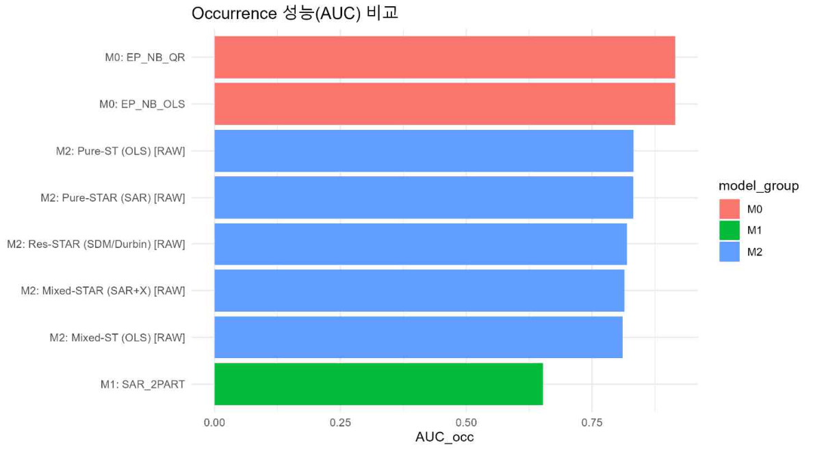

# 산불보험 — 위험 예측 및 지급규칙 평가

[Notion 상세 페이지](https://app.notion.com/p/3fe6458e68be81ab9db4c2e2c0afb9bc) · [프로필](https://github.com/donghwan-analytics)

## 산불 예측을 보험 지급 판단에 연결했습니다

2017–2025년 252개 시군구의 자료를 결합해, 정제한 일별 관측치 806,649건을 지역·연도 패널 2,225건으로 구성했습니다. 산불이 발생하는지와 발생했을 때의 피해 규모를 나누어 추정하고, 기준모형과 공간모형, 시공간모형을 비교했습니다.

DB 보험·금융 공모전 팀장으로 문제 정의, 모형 비교와 검증 구조 설계, 팀원 코드 검토를 맡았습니다. 분석 모듈의 입력과 출력 기준을 맞추고 결과 해석과 보고서를 정리했습니다.

## 복잡한 모형이 모든 평가에서 우수하지는 않았습니다

제출보고서의 시간 외 평가에서는 2017–2023년 자료 1,721건으로 학습하고, 2024–2025년 자료 504건으로 평가했습니다.

| 모형 | 산불 발생 구분력 AUC |
| --- | --- |
| 기준모형 M0 | 0.9149 |
| 공간모형 M1 | 0.6526 |
| 시공간모형 M2 | 0.8109–0.8322 |

발생 여부를 구분하는 데에는 기준모형이 가장 높았습니다. 피해 규모에서도 평가 지표에 따라 순위가 달랐습니다. 큰 오차에 민감한 RMSE에서는 기준모형이, 중위 절대오차와 로그 오차에서는 시공간모형이 유리했습니다.

## 미지급을 줄이면 무피해 지급이 늘었습니다

기준모형의 NB-OLS 방식은 평가 504건 중 피해가 있어도 지급하지 않은 비율이 0.0040으로, 약 2건에 해당했습니다. 시공간모형에서는 이러한 사례가 0건이었지만 피해가 없는데 지급하는 비율이 약 25%에서 43–44%로 늘었습니다. 보고서의 반올림된 비율을 504건에 적용하면 약 218–220건입니다.

미지급 빈도와 미보장 규모는 구분했습니다. 지급이 한 번이라도 있었다고 실제 피해를 충분히 보장한 것은 아니므로, 피해 대비 부족한 지급량도 별도로 평가했습니다.

## 오류 비용에 따라 지급 방식의 선택이 달라졌습니다

미보장과 과잉지급에 2:1의 비용 가중치를 둔 비교에서는 NB-QR 방식이 유리했습니다. 미보장 비용의 상대 가중치가 약 2.38 이상이 되면 NB-OLS 방식이 유리해졌습니다. 이 비율은 데이터에서 확정한 보험료가 아니라, 어떤 오류를 더 중요하게 볼 때 선택이 달라지는지 보여주는 기준입니다.

실제 보험금 자료가 없어 피해면적을 100ha에서 제한한 값을 손실의 대리변수로 사용했습니다. 결과는 제출보고서의 모형 비교이며 실제 상품의 지급 실적은 아닙니다.

## 데이터와 실행 범위

자료 결합 과정에서 행정구역 코드, 집계기간, 공간가중행렬의 지역 순서를 점검했습니다. 공개한 코드는 당시 모형 구현입니다. 보고서의 2024–2025년 평가 결과를 재현하려면 코드의 분할 설정과 선행 산출물이 같은 평가기간에 대응하는지 확인해야 합니다.

## 분석 그림



## 주요 구현 코드
**팀 공동 구현:** 비교 대상 모형 3종
- `Wildfire_M0.R`: 기준 Two-part 모형.
- `Wildfire_M1_SAR.R`: 공간모형.
- `Wildfire_M2_STAR.R`: 시공간모형.
**담당 범위:** 모형 비교·검증 구조 조율 및 분석 모듈 통합 점검.
**실행 조건:** 전처리된 학습·평가 자료와 공간가중행렬 등 선행 산출물이 필요합니다. 평가기간은 최종 산출물과의 대응 확인이 필요합니다.
주요 구현은 `R/`에 수록했습니다. 개인 PC 경로 설정을 변경한 파일은 `SOURCE_MANIFEST.json`에 기록했습니다. 전체 데이터·실행환경을 포함한 배포 패키지는 아닙니다.

## 저장소 파일

- [`Wildfire_M0.R`](R/Wildfire_M0.R)
- [`Wildfire_M1_SAR.R`](R/Wildfire_M1_SAR.R)
- [`Wildfire_M2_STAR.R`](R/Wildfire_M2_STAR.R)

## 실행 및 재현 안내

저장소 루트에서 R을 실행하고 `requirements-r.txt`의 패키지와 각 분석의 입력자료를 준비합니다. 원본 분석 스크립트는 패키지 설치, 결과 파일 생성, 병렬 작업을 수행할 수 있으므로 실행 범위와 경로를 먼저 확인해야 합니다.

```r
# 저장소 루트에서 실행
Sys.setenv(PORTFOLIO_PROJECT_DIR = getwd())
source("tools/preflight.R")
# 설정·입력자료 확인 후 분석 스크립트 실행
# source("R/Wildfire_M0.R")
```

- `preflight.R`는 구문과 주요 패키지만 검사하며 분석을 실행하거나 패키지를 설치하지 않습니다. 자료의 존재·변수 구조·평가기간은 개별 스크립트에서 확인해야 합니다.
- 결과 수치는 기존 보고서와 투고 원고에 근거합니다. 이번 문서 갱신에서는 분석 코드를 재실행하지 않았습니다.
- `requirements-r.txt`는 주요 의존성 목록이며 정확한 버전을 고정하는 잠금파일이 아닙니다.
- `SOURCE_MANIFEST.json`에는 원본 및 준비본 SHA-256과 변경 범위를 기록했습니다. 계산 로직은 변경하지 않았습니다.
- 데이터와 선행 분석 결과가 필요한 스크립트는 해당 입력 없이 단독 실행할 수 없습니다.

## 자료 및 권리

개인·팀 연구의 구현 사례를 설명하기 위한 포트폴리오입니다. 별도의 재사용 라이선스를 부여하지 않았으며 팀 공동 산출물과 연구자료의 권리는 해당 권리자에게 있습니다.
