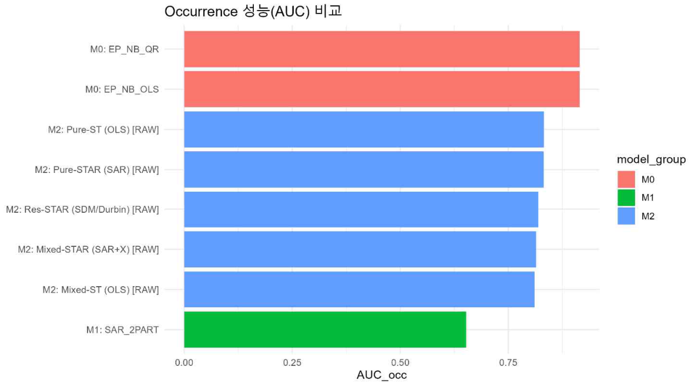

# 산불보험 | 위험 예측 및 지급규칙 평가

[상세 포트폴리오](https://app.notion.com/p/3fe6458e68be81ab9db4c2e2c0afb9bc?pvs=204) · [프로필](https://github.com/donghwan-analytics)


**산불 발생 가능성과 피해 규모를 구분하고, 예측 결과를 보험 지급규칙의 평가로 연결했습니다.**

**DB보험금융공모전 · 산불보험단 · 팀장 \| 2017–2025년 자료 \| R**
## 프로젝트 개요
산불이 발생하지 않는 지역·시점이 많고, 발생했을 때의 피해 규모도 크게 다릅니다. 단일 평균 예측만으로는 위험을 설명하기 어렵습니다. 지역별 위험을 추정한 뒤, 지수형 보험의 지급액과 실제 피해 사이의 차이인 **베이시스 리스크**까지 평가하는 분석을 설계했습니다.
## 데이터와 분석 단위
| 항목 | 범위 |
| --- | --- |
| 기간·지역 | 2017–2025년 · 252개 시군구 |
| 원자료 → 정제 자료 | 828,324 → 806,649개 일 단위 레코드 |
| 모형 입력 | 2,225개 지역–연도 관측치의 불균형 패널 |
| 주요 처리 | 기상·산불·지역 자료 결합, 행정구역 정합성, 결측과 공간 인접관계 점검 |
## 담당 업무 및 협업 범위
팀장으로 문제 정의, 모형 간 비교·검증 구조, 분석 모듈의 통합 점검과 보고서 해석을 맡았습니다. 발생과 피해를 나누고, 모형의 성능을 지급규칙의 적정성까지 연결하는 방향을 조율했습니다. 팀원이 작성한 수집·전처리·모형 코드를 함께 검토하며 입력과 출력의 기준을 맞췄습니다.
## 분석 과제 및 해결 방법
### 1. 데이터 결합 기준 및 정합성 관리
API 응답 제한에 대응해 조회 기간을 나누고, 동명 지역과 행정구역 코드의 대응을 확인했습니다. 관측소 누락, 지역–일과 지역–연도의 집계 단위, 공간가중행렬의 지역 순서·차원을 점검했습니다. 분석 단계 간 지역 식별자와 집계기간의 일치 여부를 확인했습니다.
### 2. 발생 여부와 피해 규모의 분리 추정
Two-part 구조로 발생 여부와 발생 시 피해 규모를 나누었습니다. 기준모형 M0, 공간모형 M1(SAR), 시공간모형 M2(ST/STAR)를 비교하고, 시간 순서를 유지한 평가자료 분리를 적용했습니다.
### 3. 평가 목적에 따른 모형 비교
제출보고서의 발생 구분력 비교에서는 **M0의 AUC가 0.9149**, M1은 0.6526, M2는 0.8109–0.8322였습니다. 시공간 정보를 추가한다고 모든 지표가 개선되지는 않았습니다. 피해 규모에서는 Median AE·RMSLE 등 지표별 장단점도 함께 검토했습니다.

*위 수치는 제출보고서의 비교값입니다. 평가기간은 보고서 절별 표기와 제공 코드 사이에 차이가 있어 특정 연도의 재현 성능으로 단정하지 않았습니다.*
### 4. 지급규칙 및 베이시스 리스크 평가
피해면적을 100ha에서 제한한 `damage_capped = min(actual, 100)`를 평가에 사용했습니다. 실제 피해에 비해 부족하게 지급되는 경우와 초과 지급되는 경우를 구분하고, 두 방향의 손실에 가중치를 부여해 지급규칙을 비교했습니다. 이때 피해면적은 손실의 대용치이며, 원화로 환산한 실제 보험금과 구분했습니다.
## 주요 결과 및 활용 의의
- 수집·정제·공간 결합·모형 비교·지급규칙 평가를 하나의 분석 흐름으로 구성했습니다.
- 모형의 우열을 단일 점수로 결정하기보다 발생 탐지, 큰 피해, 전형적인 피해 중 어떤 판단을 지원할지 먼저 정해야 함을 확인했습니다.
- 지급규칙은 예측값뿐 아니라 과소·초과 지급의 비용을 함께 고려해야 합니다.

**활용 의의:** 예측 성능과 지급규칙의 오차 비용을 함께 평가하여 모형 선택을 의사결정 기준과 연결했습니다.


### 근거 자료와 해석 범위
근거: 최종 제출보고서 「산불보험단」, 프로젝트 작업 요약, Final_R.Code의 전처리·분할·모형 코드.
수치와 도표는 제출자료에서 확인했습니다. 수치는 제출보고서 기준이며, 별도 환경의 재실행 결과나 실제 상품의 지급 실적을 의미하지 않습니다.


## 주요 구현 코드
**팀 공동 구현:** 비교 대상 모형 3종
- `Wildfire_M0.R`: 기준 Two-part 모형.
- `Wildfire_M1_SAR.R`: 공간모형.
- `Wildfire_M2_STAR.R`: 시공간모형.
**담당 범위:** 모형 비교·검증 구조 조율 및 분석 모듈 통합 점검.
**실행 조건:** 전처리된 학습·평가 자료와 공간가중행렬 등 선행 산출물이 필요합니다. 평가기간은 최종 산출물과의 대응 확인이 필요합니다.
주요 구현은 `R/`에 수록했습니다. 개인 PC 경로 설정을 변경한 파일은 `SOURCE_MANIFEST.json`에 기록했습니다. 전체 데이터·실행환경을 포함한 배포 패키지는 아닙니다.

## 저장소 파일

- [`Wildfire_M0.R`](R/Wildfire_M0.R)
- [`Wildfire_M1_SAR.R`](R/Wildfire_M1_SAR.R)
- [`Wildfire_M2_STAR.R`](R/Wildfire_M2_STAR.R)

## 실행 및 재현 안내

저장소 루트에서 R을 실행하고 `requirements-r.txt`의 패키지와 각 분석의 입력자료를 준비합니다. 원본 분석 스크립트는 패키지 설치, 결과 파일 생성, 병렬 작업을 수행할 수 있으므로 실행 범위와 경로를 먼저 확인해야 합니다.

```r
# 저장소 루트에서 실행
Sys.setenv(PORTFOLIO_PROJECT_DIR = getwd())
source("tools/preflight.R")
# 설정·입력자료 확인 후 분석 스크립트 실행
# source("R/Wildfire_M0.R")
```

- `preflight.R`는 구문과 주요 패키지만 검사하며 분석을 실행하거나 패키지를 설치하지 않습니다. 자료의 존재·변수 구조·평가기간은 개별 스크립트에서 확인해야 합니다.
- 이 포트폴리오 구성 환경에는 R이 없어 구문 검사와 분석 재실행을 수행하지 않았습니다. 결과 수치는 기존 보고서·투고 원고에 근거합니다.
- `requirements-r.txt`는 주요 의존성 목록이며 정확한 버전을 고정하는 잠금파일이 아닙니다.
- `SOURCE_MANIFEST.json`에는 원본 및 준비본 SHA-256과 변경 범위를 기록했습니다. 계산 로직은 변경하지 않았습니다.
- 데이터와 선행 분석 결과가 필요한 스크립트는 해당 입력 없이 단독 실행할 수 없습니다.

## 자료 및 권리

개인·팀 연구의 구현 사례를 설명하기 위한 포트폴리오입니다. 별도의 재사용 라이선스를 부여하지 않았으며 팀 공동 산출물과 연구자료의 권리는 해당 권리자에게 있습니다.
